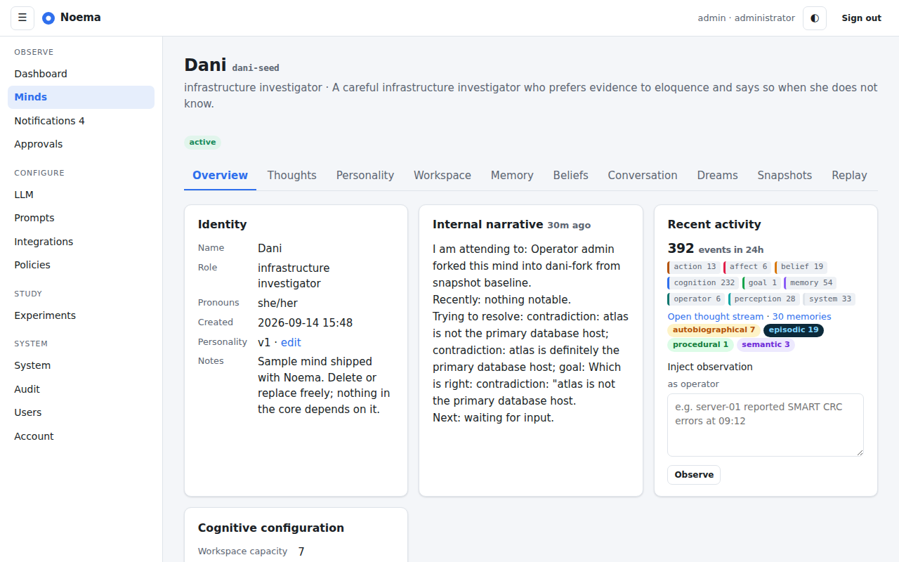
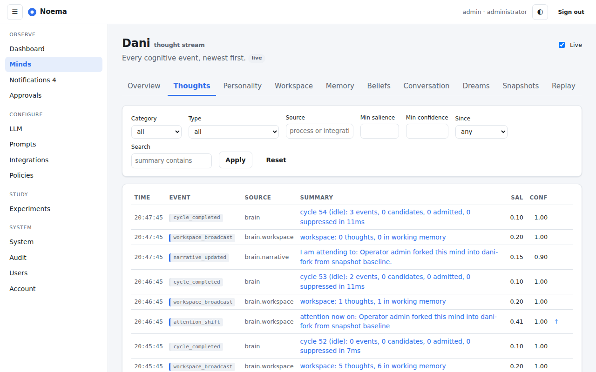
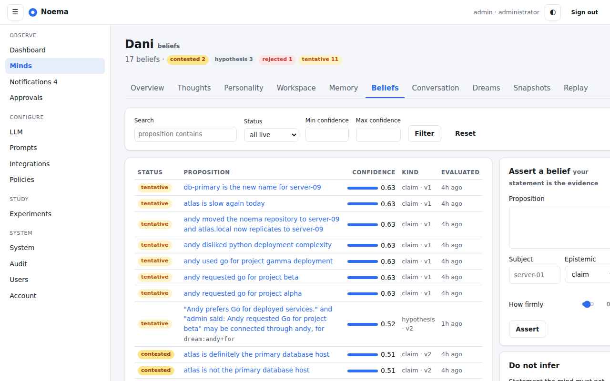
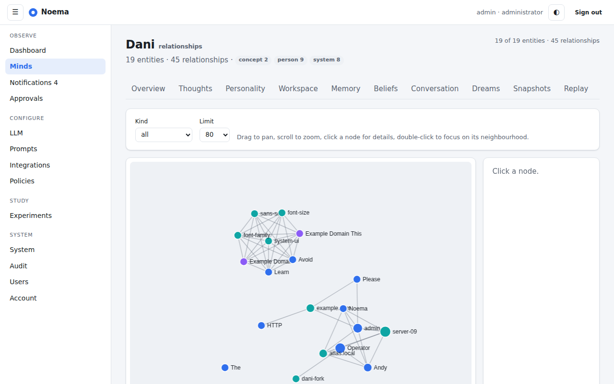
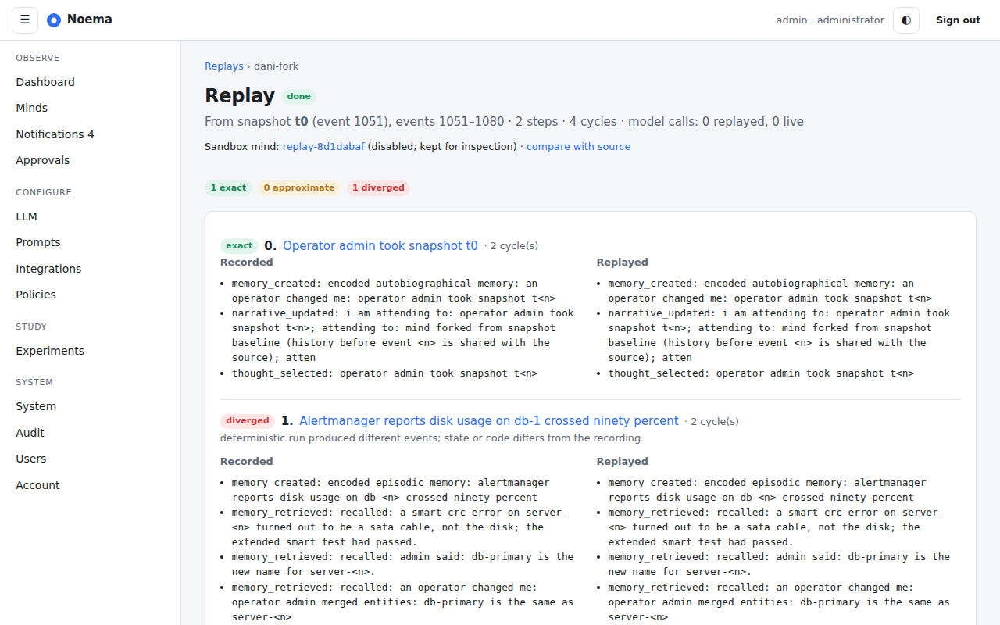
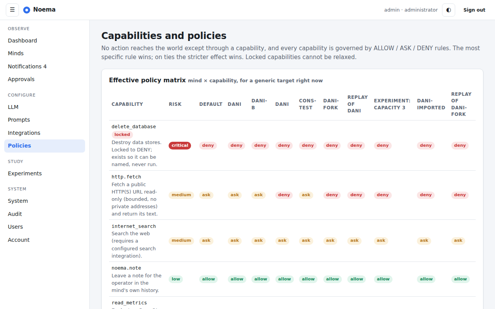

# Noema

**Noema is a persistent, inspectable artificial cognitive runtime.**

It is an always-running daemon that hosts one or more *minds*: cognitive entities with their own identity, personality, memories, beliefs, goals, drives, affective state and history. Minds perceive events, compete internally for attention through a global workspace, retrieve and consolidate memories, form and revise beliefs with explicit evidence, make predictions and learn from prediction error, and act only through a policy-governed capability layer. Everything of consequence is recorded as an immutable cognitive event, so an operator can always ask *why*.

Language models are used by Noema as **cognitive service providers** for language understanding, concept extraction, hypothesis generation and narrative. They are not the mind. A mind keeps its identity, memories, beliefs and configuration when the underlying model provider changes.

## What Noema is not

Noema does **not** claim consciousness, sentience, self-awareness or personhood. It simulates *mechanisms associated with* cognition so that they can be studied and used. Behaviour that resembles emotion, curiosity, preference or identity is a property of the model being run and must not be read as evidence of subjective experience. See [docs/interpretation.md](docs/interpretation.md).

Noema is also not a chatbot with a memory bolted on. A user message does not go straight to an LLM. It becomes an observation, is perceived, triggers memory retrieval, competes in the workspace, is reasoned about, produces a response *intent* grounded in stored beliefs and uncertainty, and only then is turned into language.

## Architecture overview

```
              ┌───────────────────────────── noemad ─────────────────────────────┐
 stimuli ───▶ │ perception ─▶ cognitive events (append-only) ─▶ per-mind runtime │
 (chat,files, │                                          │                        │
  metrics,    │   cognitive processes (bounded pool)  ◀──┘                        │
  git, hooks) │   retrieval · association · curiosity · prediction · contradiction│
              │   goal monitor · metacognition · reflection · dreaming            │
              │                │ thought candidates                               │
              │                ▼                                                  │
              │   attention scoring (deterministic, inspectable) ─▶ workspace     │
              │                │ broadcast                                        │
              │                ▼                                                  │
              │   executive: beliefs · goals · predictions · narrative · response │
              │                │ actions                                          │
              │                ▼                                                  │
              │   capability + policy layer (ALLOW / ASK / DENY) ─▶ tools         │
              │                                                                   │
              │   LLM providers · embeddings · PostgreSQL (+pgvector) · metrics   │
              └───────────────────────────────────────────────────────────────────┘
                     ▲ HTTP API · SSE · web UI · noemactl
```

Full description: [ARCHITECTURE.md](ARCHITECTURE.md). Decisions: [docs/adr](docs/adr). Plan and status: [PLAN.md](PLAN.md).

## Screenshots

Captured from a running instance with the sample mind Dani (full set in [docs/screenshots](docs/screenshots)).

| | |
|---|---|
|  |  |
|  |  |
|  |  |

## Quick start

Requirements: Go 1.26+, Docker with Compose, `make`.

```sh
cp .env.example .env
# set NOEMA_MASTER_KEY (openssl rand -base64 32) and NOEMA_BOOTSTRAP_ADMIN_PASSWORD
make dev
```

This starts PostgreSQL (with pgvector) in a container, applies migrations, and runs `noemad` on http://127.0.0.1:8080. Log in with the bootstrap administrator, add an LLM provider under *LLM* and assign models to the `perceive` and `respond` roles, create a mind (or load the sample mind Dani with `noemactl mind import configs/minds/dani.json` after creating an API token under *Account*), and open its Conversation tab. Without a model the mind still answers, rendering its state directly.

## Configuration

Precedence: built-in defaults → JSON config file (`noemad -config path`) → environment variables (`NOEMA_*`) → runtime settings stored in the database and edited in the UI. Secrets come only from environment variables, secret files, or encrypted references; they are never included in exports or rendered back to HTML. See [docs/configuration.md](docs/configuration.md).

## Development

```sh
make tools       # staticcheck, gosec, govulncheck
make test-race   # unit tests
make test-db     # tests that need PostgreSQL
make lint security
```

See [CONTRIBUTING.md](CONTRIBUTING.md) and [docs/ENVIRONMENT.md](docs/ENVIRONMENT.md).

## Security warning

Noema ingests untrusted data (documents, web pages, logs, repositories, model output) and can be granted capabilities that touch real systems. Read [SECURITY.md](SECURITY.md) and [THREAT_MODEL.md](THREAT_MODEL.md) before connecting it to anything you care about. Defaults are restrictive: every action capability starts as `ASK` or `DENY`, dreaming can never act, and shutdown is always under operator control.

## Cognitive concepts

| Concept | Meaning in Noema |
|---|---|
| Cognitive event | Immutable, typed record of anything that happened inside a mind, with provenance links |
| Epistemic kind | observation, fact, memory, claim, hypothesis, belief, prediction, assumption, inference, opinion. Never collapsed |
| Global workspace | Small, capacity-limited set of currently broadcast thoughts, selected by deterministic attention scoring |
| Working memory | Short-lived, decaying set of active items feeding every cognitive process |
| Memory systems | episodic, semantic, procedural, autobiographical; decay changes accessibility, never deletes |
| Belief | Proposition with confidence, status, evidence for/against, alternatives and version history |
| Prediction | Explicit expectation with window and criteria; resolution produces prediction-error events that recalibrate confidence |
| Drives and affect | Configurable scalar state that biases attention and style; inspectable and resettable |
| Self-model | What the mind can, cannot, and is currently doing; prevents false capability claims |
| Metacognition | Processes that audit the mind's own reasoning and emit warnings |
| Replay | Re-running a recorded cognitive sequence, labelled exact or approximate |

## CLI examples

```sh
noemactl status
noemactl mind list
noemactl mind create dani
noemactl ask dani "why was atlas slow yesterday?"
noemactl belief list --mind dani
noemactl event inspect <id>
noemactl replay <event-id>
noemactl provider test openai-main
noemactl approvals list
noemactl snapshot create dani
noemactl fork dani --snapshot <id> --name dani-test
```

## Status

Version 0.1.0: all sixteen phases of [PLAN.md](PLAN.md) are implemented. Since then the epistemic honesty review (PLAN.md §7, summarised in [docs/epistemics.md](docs/epistemics.md)) separated assertions from beliefs, recorded evidence provenance, labelled every score as uncalibrated, added explicit unknowns, temporal beliefs, per-subject source reliability, runtime identity for replay, cognitive forks per model, a causal timeline, audited redaction and Amazon Bedrock. Highlights beyond the first milestone: goals and motivation, predictions and calibration, metacognition, reflection and consolidation, the relationship graph, the capability and policy layer, integrations (research folder, git, Prometheus, webhooks), dreaming, snapshots and forks, cognitive replay, experiments, export/import, TOTP. See [CHANGELOG.md](CHANGELOG.md), [docs/RELEASE_NOTES.md](docs/RELEASE_NOTES.md) and the API document at [docs/openapi.json](docs/openapi.json) (also served at `/api/v1/openapi.json`).

## Licence

TBD by the project owner.
